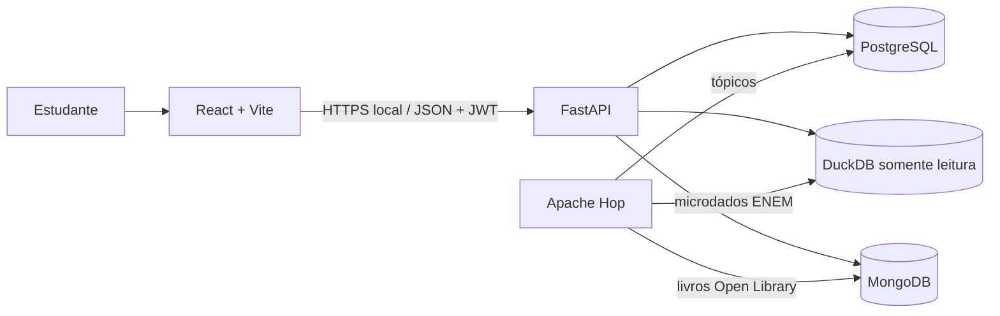

# Arquitetura e fluxo de dados

O RotaENEM é uma aplicação de demonstração executada localmente. O Front-End React chama uma API FastAPI; a API consulta PostgreSQL, DuckDB e MongoDB conforme a funcionalidade.

## Componentes em execução

## Responsabilidade de cada banco

- **PostgreSQL:** estudantes e hashes de senha, metas por curso/área, simulados/notas, tópicos e planos/sessões semanais.
- **DuckDB:** médias de referência por ano e estado das notas do ENEM. A API abre o arquivo em modo somente leitura; o Hop carrega a tabela analítica.
- **MongoDB:** documentos de conteúdo coletados pelo Hop. A API procura por sigla da área e nome do tópico e retorna o conteúdo associado a uma sessão.

## Fluxo de dados

1. O estudante cria a conta e entra. A API retorna um token JWT; as rotas de dados exigem `Authorization: Bearer <token>`.
2. Meta e notas dos simulados são persistidas no PostgreSQL.
3. `GET /desempenho/me` combina a meta e o simulado mais recente com as médias do DuckDB. Calcula o ganho necessário e a prioridade ponderada por área.
4. O estudante gera um plano. A API distribui as horas entre áreas prioritárias, busca tópicos no PostgreSQL, consulta conteúdos compatíveis no MongoDB e salva as sessões no PostgreSQL.
5. O Front-End consulta meta, simulados, desempenho e plano. O dashboard usa esses mesmos dados para mostrar curso, notas, prioridade, carga planejada e próximas sessões.

## Atualização dos materiais no plano

Ao gerar um plano, a API busca conteúdo pela combinação `area` + `topico` no MongoDB e persiste o `_id` encontrado em `plano_item.conteudo_ref`. Ao consultar um plano existente, a API resolve essa referência pelo `_id`. Portanto, se os conteúdos forem carregados depois que um plano já existe, gere o plano novamente para criar as referências.

## Limites conhecidos

- A tela mostra **horas planejadas**, não horas efetivamente estudadas. Ainda não existe endpoint ou persistência para registrar conclusão de sessões.
- Notas atuais do estudante são informadas ao registrar simulados; elas não são extraídas automaticamente dos microdados do INEP.
- A carga de conteúdos implementada usa a Open Library. YouTube e Google Books são fontes do desenho inicial, não do workflow atual.
- As médias do ENEM dependem do arquivo DuckDB e das views criadas pelo schema. Se ele não estiver disponível, o desempenho do estudante ainda pode ser retornado sem as médias de referência.
- O token fica no armazenamento local do navegador e expira conforme `JWT_ACCESS_TOKEN_EXPIRE_MINUTES`.
