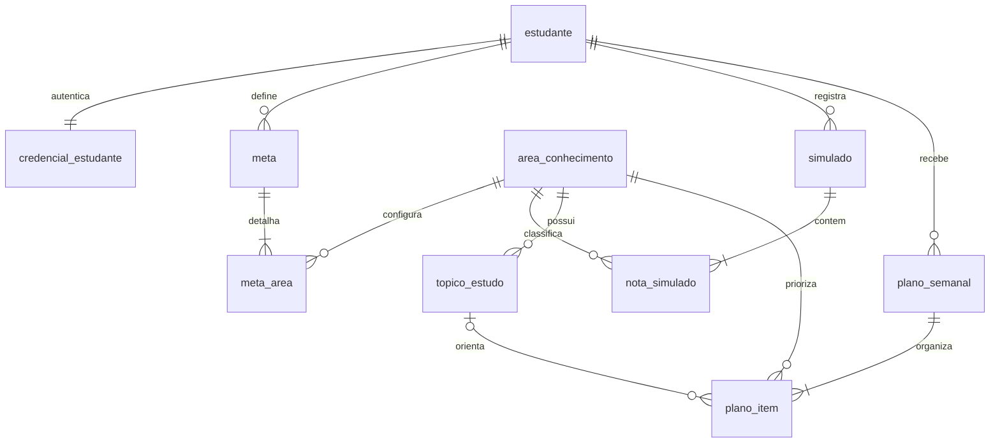

# Modelo de dados e bancos

O projeto combina PostgreSQL para dados da aplicação, DuckDB para estatísticas do ENEM e MongoDB para conteúdos coletados. Os schemas executáveis estão em `backend/database/`.

## PostgreSQL



Tabelas principais:

| Tabela | Uso |
| --- | --- |
| `estudante`, `credencial_estudante` | Perfil e hash da senha; senha em texto puro não é armazenada |
| `area_conhecimento`, `topico_estudo` | Cinco áreas do ENEM e tópicos/termos usados na coleta |
| `meta`, `meta_area` | Curso, nota de corte, data da prova e nota-alvo/peso por área |
| `simulado`, `nota_simulado` | Histórico e notas por área |
| `plano_semanal`, `plano_item` | Plano por semana e sessões com horas, data, horário, prioridade e referência do conteúdo |

O estudante referencia sua meta atual pela meta mais recente. `plano_item.conteudo_ref` é texto e armazena o `_id` do documento Mongo associado.

## DuckDB

Tabela `enem_notas` armazena `ano`, `uf`, `nota_cn`, `nota_ch`, `nota_lc`, `nota_mt` e `nota_red`. As views `enem_media_uf_area` e `enem_media_nacional_area` calculam as médias por estado e nacional. A API acessa o arquivo em modo somente leitura.

Na demonstração executada em 13/11/2026, a pipeline leu até 10.000 linhas do CSV e gravou 9.999 registros: uma linha era cabeçalho e foi ignorada. O limite está configurado em `pl_01_carga_enem.hpl` para manter a carga pequena. A pipeline trunca somente a tabela analítica `enem_notas` antes da carga.

## MongoDB

Banco e coleção padrão: `rotaenem.conteudos`. Cada livro coletado pelo Hop pode conter campos como (o valor de `topico_id` depende dos IDs gerados no PostgreSQL):

```json
{
  "topico_id": 8,
  "area": "LC",
  "topico": "Gêneros textuais",
  "termo_busca": "gêneros textuais ENEM",
  "key": "/works/OL123W",
  "titulo": "Título retornado pela Open Library",
  "ano_publicacao": 2004
}
```

O `_id` é gerado pelo MongoDB. O Hop usa `topico_id` e `key` para localizar o documento no upsert; os demais campos são atualizados com `$set`. A escrita não trunca a coleção.

Na leitura, o Back-End procura por igualdade de `area` e por `topico` sem diferenciar maiúsculas/minúsculas, salva o `_id` escolhido como `conteudo_ref` no PostgreSQL e resolve a referência quando retorna o plano. O normalizador constrói a URL Open Library com base no `key` se o documento ainda não tiver `url`.

## Arquivos de schema e carga

- PostgreSQL: `backend/database/postgres/schema.sql` e `seed.sql`.
- Migration para plano com agenda: `backend/database/postgres/migrations/001_plano_semanal_agenda.sql`.
- DuckDB: `backend/database/duckdb/schema.sql` e `db.py`.
- Documento exemplo MongoDB: `backend/database/mongodb/conteudos.example.json`.
- Pipelines que gravam bancos: `hop/pipelines/`.
